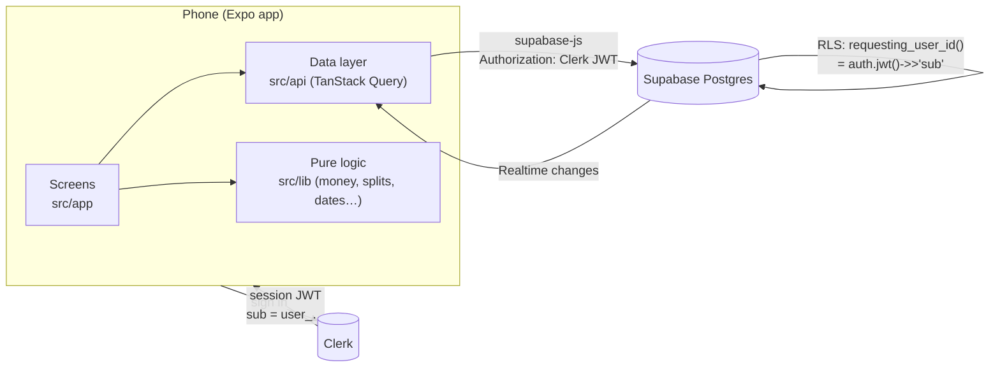

# MitiMiti

[](https://github.com/daardilava/mitimiti/actions/workflows/ci.yml)


**A shared-budget app for couples.** It answers one question in under five seconds:
**who owes whom, and how much?**

Two people log what they spend together, choose how each expense is split, and see one live balance on both
phones. When they settle up outside the app, they record the payment and the balance goes back to zero.

> **Status:** private beta in preparation. Phases 1–3 are built (live checks open); Phase 6 (*Billing*) is built,
> with its store QA on real phones still open.
> Roadmap and acceptance checks: [docs/PLAN.md](docs/PLAN.md).

---

## Contents

- [What it does](#what-it-does)
- [Tech stack](#tech-stack)
- [Architecture](#architecture)
- [Getting started](#getting-started)
- [Environment variables](#environment-variables)
- [Scripts](#scripts)
- [Project structure](#project-structure)
- [Testing](#testing)
- [Database and migrations](#database-and-migrations)
- [Engineering rules](#engineering-rules)
- [Contributing](#contributing)
- [Documentation](#documentation)
- [License](#license)

---

## What it does

| Feature | Description | Status |
| --- | --- | --- |
| Couple account | Sign in with email + password, Google or Apple (Clerk); one shared space joined with a 6-character code | Built |
| Log an expense | Amount, description, who paid, category, date; a new expense in under 10 seconds | Built |
| Flexible splits | Half and half, by percentage (1–99 %), all for the other person, or personal | Built |
| Live balance | "Ana te debe $337.950", computed from every expense and payment, synced in real time | Built |
| Movimientos | A day, week or month of activity with a spending chart, search, filters and a calendar picker | Built |
| Settle up | Record a full or partial payment by transfer, cash or other; never more than what is owed | Built |
| Monthly summary | Shared total by category, who paid, each person's share, personal spending | Built |
| Budgets | Monthly limit per category, warning at 80 %, over-limit state | Built |
| Settings | Names, avatar, default split, currency, appearance (light / dark), language (es / en / de) | Built |
| Export | The expenses and payments of a period as a CSV for spreadsheets, or a PDF report with totals and the balance, through the share sheet | Built |
| Notifications | Partner activity, Sunday reminder | Planned (v1.1) |
| Offline logging, recurring expenses | Save without signal; rent and subscriptions each month | Planned (v1.2) |
| Premium | One subscription per couple in the App Store / Google Play: full history, budgets, export | Built; store testing open (Phase 6) |

**Product principles:** two people, never a group · fair, not just 50/50 · fast to log · the app records
payments, it never moves money · neutral, no-blame language.

## Tech stack

| Layer | Choice |
| --- | --- |
| App | [Expo](https://expo.dev) SDK 57, React Native 0.86, React 19, TypeScript (strict) |
| Navigation | Expo Router (file-based, typed routes) |
| Auth | [Clerk](https://clerk.com) (`@clerk/expo`): email + password, Google, Apple |
| Data | [Supabase](https://supabase.com): Postgres, Row Level Security, Realtime |
| Server state | TanStack Query |
| Validation | Zod |
| Tests | Vitest, with SQL and RLS tests running on [PGlite](https://pglite.dev) (Postgres in WebAssembly) |
| Delivery | EAS Build / Submit / Update, GitHub Actions |

## Architecture



- **Clerk owns identity; Supabase owns data.** Supabase trusts Clerk as a third-party auth provider, and every
  row is protected by RLS keyed on the Clerk user id. Supabase Auth is not used for sign-in.
- **The balance is never stored.** It is computed from expenses and payments in SQL (`balance_view`) and,
  identically, in the app (`src/lib/splits.ts`). A parity test keeps both in sync.
- **Every write that touches money is one Postgres function** (one transaction), e.g. `upsert_expense`,
  `record_settlement`. Deletes are soft and every change is written to `audit_log`.
- **Both phones stay in sync** through Supabase Realtime plus a refetch when the app returns to the foreground.

Details: [docs/ARCHITECTURE.md](docs/ARCHITECTURE.md).

## Getting started

### Prerequisites

- **Node.js 24** (see [`.nvmrc`](.nvmrc)) and npm
- **Expo Go** on a phone, or an Android emulator / iOS simulator
- **Docker Desktop**, only to run Supabase locally

### 1. Install

```bash
git clone https://github.com/daardilava/mitimiti.git
cd mitimiti
npm install
cp .env.example .env
```

### 2. Run with sample data (no backend needed)

Set `EXPO_PUBLIC_DEV_BYPASS_AUTH=1` in `.env`. Sign-in is skipped and every screen is reachable with built-in
sample data.

```bash
npx expo start            # scan the QR code with Expo Go, or press a / i / w
```

### 3. Run against a real backend

1. Start Supabase locally (or use the hosted project's URL and publishable key):
   ```bash
   npm run db:start       # prints the local URL and keys for .env
   npm run db:reset       # applies supabase/migrations/*
   ```
2. Add your Clerk publishable key to `.env`. The Clerk instance must have the Supabase integration enabled
   (see *Set up Clerk* in [docs/PLAN.md](docs/PLAN.md)). Verify it with `npm run clerk:check`.
3. Set `EXPO_PUBLIC_DEV_BYPASS_AUTH=0` and run `npx expo start`.

Google and Apple sign-in open the system browser through Clerk (`useSSO`). This works in Expo Go, on web
and in development builds (`npx expo run:android` / `run:ios`).

> Add packages with `npx expo install <package>`, never `npm install <package>`: it picks the version
> that matches the Expo SDK.

## Environment variables

All variables are `EXPO_PUBLIC_*`, which means they are **bundled into the app and public by design**.
Never put a secret (service-role key, Clerk secret key) in `.env`. Template: [`.env.example`](.env.example).

| Variable | Description |
| --- | --- |
| `EXPO_PUBLIC_SUPABASE_URL` | Supabase project URL (`http://127.0.0.1:54321` locally) |
| `EXPO_PUBLIC_SUPABASE_KEY` | Supabase publishable / anon key. Safe in the app: RLS guards every row |
| `EXPO_PUBLIC_CLERK_PUBLISHABLE_KEY` | Clerk publishable key (`pk_test_…` in development) |
| `EXPO_PUBLIC_DEV_BYPASS_AUTH` | `1` = skip sign-in and use sample data. Development only |
| `EXPO_PUBLIC_REVENUECAT_IOS_KEY` | RevenueCat public SDK key for iOS (`appl_…`). Empty = no purchases |
| `EXPO_PUBLIC_REVENUECAT_ANDROID_KEY` | RevenueCat public SDK key for Android (`goog_…`). Empty = no purchases |

**Server-side secrets** never go in `.env` or the app. They live in Supabase (`npx supabase secrets set`):

| Secret | Used by |
| --- | --- |
| `REVENUECAT_WEBHOOK_AUTH` | The billing webhook: the secret RevenueCat sends in its Authorization header (with or without `Bearer `) |
| `REVENUECAT_SECRET_API_KEY` | `billing-sync`: RevenueCat secret API key (`sk_…`), to read a customer's current state |

## Scripts

| Command | What it does |
| --- | --- |
| `npx expo start` | Start the dev server |
| `npm run typecheck` | TypeScript, no emit |
| `npx expo lint` | ESLint (Expo config) |
| `npm test` | All Vitest suites, app logic and SQL |
| `npm run clerk:check` | Check that the Clerk instance in `.env` is configured the way the app signs in |
| `npm run db:start` | Start local Supabase (Docker) |
| `npm run db:reset` | Recreate the local database from `supabase/migrations` |
| `npm run db:types` | Regenerate `src/lib/database.types.ts` from the local schema |

## Project structure

```
src/
  app/              Expo Router routes, one file per screen
    (onboarding)/   Signed-out flow: welcome, sign-in/up, forgot password, setup, join
    (tabs)/         Main app: Inicio, Movimientos, Resumen, Ajustes
                    plus expense, settle, budgets, invite, export, paywall, terms, privacy, delete-account
  api/              Clerk and Supabase calls, TanStack Query hooks, Realtime
  lib/              Pure, tested logic: money, splits, balance, dates, activity, budgets, settle…
    __tests__/
  ui/               Design tokens (light + dark), theme, Miti and the wordmark, icons, shared components
  i18n/             Messages in Spanish (source of truth), English and German; legal texts
assets/             App icon, adaptive icon, splash, favicon (generated)
  brand/            MitiMiti brand SVGs: Miti and its expressions, app icon
  store/            Store listing icon
supabase/
  migrations/       Schema, RLS policies and SQL functions, in order
  functions/        Edge Functions: revenuecat-webhook, billing-sync
  tests/            SQL / RLS tests on PGlite, and app ↔ SQL split parity
docs/               Plan, design, architecture and the billing runbook
scripts/            Clerk configuration check; brand-assets.py renders assets/ from assets/brand
```

## Testing

```bash
npm test
```

| Suite | Covers |
| --- | --- |
| `src/lib/__tests__` | Money formatting and parsing, splits and balance, dates, activity, budgets, settle up, summary, auth flow, plans and paywall, export (CSV, PDF), the Miti logo |
| `src/ui/__tests__` | WCAG contrast of every colour pair (brand colours included), in light and dark mode |
| `src/i18n/__tests__` | Every language has every message |
| `supabase/tests` | Migrations applied to PGlite: RLS isolation between couples, every SQL function, billing and account deletion, and **split parity**: the SQL and the app compute the same balance for every split mode |

The balance must never be wrong, so any change to split or balance math, in SQL or TypeScript, must keep
`supabase/tests/splits_parity.test.ts` passing. CI runs typecheck, lint and tests on every push and pull request.

## Database and migrations

- Migrations live in `supabase/migrations/` and are applied in filename order.
- **A migration that has been applied to the hosted project is never edited.** Add a new file instead:
  ```bash
  npx supabase migration new <short_description>
  ```
- Every new SQL or RLS behaviour gets a test in `supabase/tests/` (shared setup in `supabase/tests/db.ts`).
- Ship to the hosted project:
  ```bash
  npx supabase migration list --linked   # what the hosted project is missing
  npx supabase db push --dry-run         # review
  npx supabase db push                   # apply
  ```
  Ship the migration **before** the app code that depends on it, and keep the app tolerant of the previous
  schema until every phone has updated.

### Deploy the billing webhook

Two functions write each couple's Premium (Phase 6, [docs/PLAN.md](docs/PLAN.md)); push the billing migrations first:
[`revenuecat-webhook`](supabase/functions/revenuecat-webhook/index.ts) receives RevenueCat's events, and
[`billing-sync`](supabase/functions/billing-sync/index.ts) is called by the app (after creating or joining a couple,
a purchase, or Restaurar compras) to read the person's current state from RevenueCat's REST API.

1. Make a long random secret, and store the header value RevenueCat will send:
   ```bash
   npx supabase secrets set REVENUECAT_WEBHOOK_AUTH="Bearer $(openssl rand -hex 32)"
   npx supabase secrets list            # check it is there (the value is not shown)
   ```
   Keep a copy of the whole value (`Bearer …`) for step 3, in a password manager, never in the repo.
   Then the secret API key for `billing-sync` (RevenueCat › Project settings › API keys › Secret API keys, `sk_…`):
   ```bash
   npx supabase secrets set REVENUECAT_SECRET_API_KEY=sk_your-secret-key
   ```
2. Deploy both. Neither gets a token the gateway knows (RevenueCat sends none; the app sends Clerk's), so JWT
   verification is off for them (`verify_jwt = false` in `supabase/config.toml`; the flag says the same). Each checks
   its caller itself: the webhook its shared secret, `billing-sync` the Clerk session through Supabase.
   ```bash
   npx supabase functions deploy revenuecat-webhook --no-verify-jwt
   npx supabase functions deploy billing-sync --no-verify-jwt
   ```
3. RevenueCat › Project › Integrations › Webhooks › Add:
   - URL: `https://<project-ref>.supabase.co/functions/v1/revenuecat-webhook`
   - Authorization header: the same `Bearer …` value as in step 1 (the function also accepts the secret without
     `Bearer `, and ignores surrounding spaces; a refused request's answer gives the shape of what arrived, never
     the secret)
   - Send a **test event**: the function answers 200 and stores it in `billing_events`.
4. The function answers 200 for everything it handled (duplicates and `TEST` included), 401 without the right
   header, 400 for a body that isn't an event, and 500 when the database fails, so RevenueCat retries.
   Logs: Supabase Dashboard › Edge Functions › revenuecat-webhook › Logs.

## Engineering rules

These are not style preferences. Breaking one is a bug.

- **Money is an integer in minor units** (pesos, cents), never a float. Format and parse only through
  `src/lib/money.ts`. COP has 0 decimals, EUR and USD 2. Currencies are never converted.
- **The balance is never stored**, always computed. When a split leaves an odd unit, the payer keeps it.
- **User ids are Clerk ids** (`text`, `user_…`), not `uuid`. In SQL use `requesting_user_id()`, never `auth.uid()`.
- **Expense writes are atomic:** an expense and its shares change in one Postgres function.
- **Soft deletes and an audit trail:** `deleted_at`, plus a row in `audit_log` for every change. The one exception is
  deleting an account (`delete_account()`), which erases the couple's rows for the right to erasure.
- **`spent_on` is a `date`**, never a timestamp, so time zones never move an expense to another day.
- **Exactly two members per couple.**
- **Design:** colours only from `useTheme()`, styles from `makeStyles()`. No raw hex. Every screen works in
  light and dark mode. Colour is never the only cue. Touch targets are at least 44 × 44. One primary button per screen.
- **Copy:** UI text in Spanish first (`src/i18n/es.ts`), neutral and no-blame. Code, comments and docs in English.

## Contributing

Work happens on short-lived branches and lands on `main` through pull requests with green CI.
See [CONTRIBUTING.md](CONTRIBUTING.md) for branch names, commit style and the review checklist.

## Documentation

| Document | Contents |
| --- | --- |
| [docs/PLAN.md](docs/PLAN.md) | Product principles, features, roadmap, phase acceptance checks, Clerk setup, billing, open questions |
| [docs/BILLING.md](docs/BILLING.md) | Billing runbook: App Store, Google Play and RevenueCat setup, sandbox testing, release checklist |
| [docs/DESIGN.md](docs/DESIGN.md) | Screens and their routes, the MitiMiti brand (logo, icon, splash, colours), design system (UI kit v1) |
| [docs/ARCHITECTURE.md](docs/ARCHITECTURE.md) | Stack, Clerk ↔ Supabase wiring, data model, code layout |
| [CONTRIBUTING.md](CONTRIBUTING.md) | How to propose and review changes |
| [SECURITY.md](SECURITY.md) | Keys, data protection, reporting a vulnerability |
| [CLAUDE.md](CLAUDE.md) / [AGENTS.md](AGENTS.md) | Working rules for AI coding assistants |

## License

Proprietary. Copyright © 2026 Diego Armando Ardila Vargas. All rights reserved. See [LICENSE](LICENSE).
